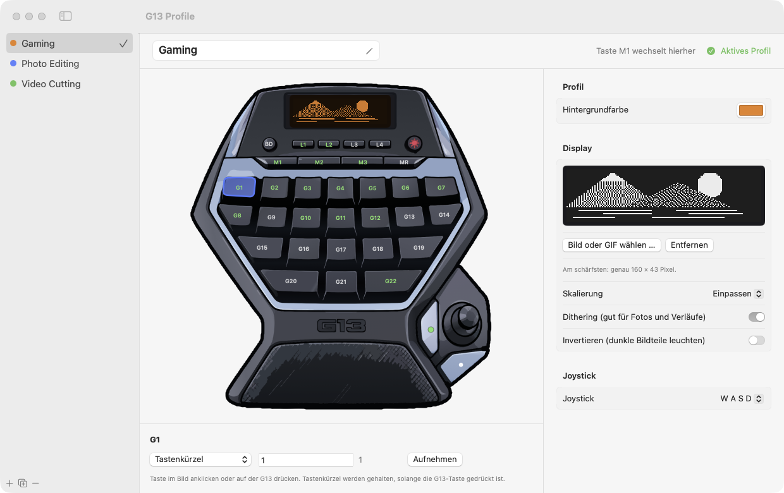

# G13forever

**A macOS driver for the Logitech G13.** Profiles, key bindings, and your own
images or animated GIFs on the 160x43 display. A menu bar app, no kernel
driver, no root.

> [!IMPORTANT]
> **Built with Claude.** This project was made with Claude, Anthropic's AI:
> Claude writes the code and the docs (yes, this README too), I decide where it
> goes and test it on a real G13. If you have a problem with AI, no hard
> feelings, but this is not the project for you. Feel free to look elsewhere.
> Everyone else: welcome!

<picture>
  <source media="(prefers-color-scheme: dark)" srcset="docs/screenshot-dark.png">
  
</picture>

## Get it

You need macOS 14 or newer. Download the finished app, or build it yourself.

### Download

1. Download
   [**G13forever.zip**](https://github.com/Obsouleet/G13forever/releases/latest/download/G13forever.zip)
   ([all versions](https://github.com/Obsouleet/G13forever/releases)), open it,
   and move **G13forever** to your **Applications** folder.
2. Open G13forever. **macOS will refuse the first time** and say it can't check
   the app: a download that opens without this warning needs a paid Apple
   developer membership, and I'm not paying for one. Close the message. Don't
   move the app to the Trash.
3. Open **System Settings > Privacy & Security**, scroll down to **Security**,
   and click **Open Anyway** next to G13forever. Confirm with your password.
   The button is only there for about an hour after step 2; open the app again
   if it's gone.
4. A keyboard icon appears in the menu bar. Plug in the G13 and
   [allow key presses](BUILDING.md#step-6-allow-key-presses).

Only do this if you trust this project: "Open Anyway" skips Apple's check for
malware. If you'd rather not, build the app from the source code instead.

**Updates:** Quit the app, replace it in Applications with the new download, and
repeat steps 2 and 3. **Then you must allow key presses again**, because macOS
treats every version as a new app: go to **System Settings > Privacy & Security >
Accessibility**, remove the old G13forever entry with **−**, and add the app
again with **+**. Your profiles are kept.

### Build it yourself

It's free, and copy and paste will get you there. No Apple developer membership,
no warning, and with your own free certificate the permission survives updates.

👉 **[Step-by-step build guide](BUILDING.md)** (no programming knowledge needed)

Short version, if you already have Xcode:

```sh
git clone https://github.com/Obsouleet/G13forever.git
cd G13forever
scripts/build-app.sh
open build/G13forever.app
```

Building needs Xcode (free); the Command Line Tools alone are not enough.

Tested with Xcode 27.2 on macOS 27.3 on Apple silicon. The download also
contains a version for Intel Macs, but neither Intel Macs nor older macOS
versions have been tested.

## What it does

The app speaks English, and German if your Mac does.

A keyboard icon appears in the menu bar. From there you pick the active
profile, open the editor (**Edit Profiles…**) and turn on **Launch at Login**.
Each profile has:

- **Name and backlight color** of the G13.
- **Image or GIF** for the display, with preview, scaling, dithering or
  threshold, and invert. Without an image, the display shows the profile name.
  Graphics of exactly 160x43 pixels look best.
- **Joystick**: off, arrow keys, or W/A/S/D.
- **Key bindings** for G1–G22, the thumb keys, the stick, BD, L1–L4 and
  M1–M3/MR: a keyboard shortcut (e.g. `cmd+shift+4`, `f5`, `space`, or recorded
  with **Record**), typed text, a switch to a specific profile, or the
  next/previous profile. Shortcuts stay pressed as long as you hold the G13
  key, so they work in games too. Pick a key by clicking it in the picture or
  by pressing it on the G13; its settings appear right below. Bound keys are
  labeled green.

By default, M1, M2 and M3 switch to profiles 1, 2 and 3, and the matching LED
lights up. If the profile has an image, its name flashes up first when you
switch.

Profiles are stored in `~/Library/Application Support/G13forever/profiles.json`,
images next to it in the `Images` folder.

### Permissions

- **Accessibility**: required, so the app may send key
  presses. The app asks on first launch.
- **Input Monitoring**: only if macOS refuses access to
  the G13.

The [build guide](BUILDING.md#step-6-allow-key-presses) shows where to find both.

## Command line tool: g13ctl

Without a G13 (preview in the terminal only):

```sh
swift run g13ctl preview --pattern
swift run g13ctl preview --text "Hello G13"
swift run g13ctl preview ~/Pictures/logo.png --fill
```

With a G13 plugged in (quit the app first so they don't compete for the display):

```sh
swift run g13ctl info                       # is the G13 found?
swift run g13ctl pattern                    # test pattern
swift run g13ctl text "Hello"
swift run g13ctl image ~/Pictures/animation.gif
swift run g13ctl backlight 255 80 0         # orange
swift run g13ctl keys                       # watch keys and joystick
swift run g13ctl clear                      # clear the display
```

Image options: `--fit` (default), `--fill`, `--stretch`, `--threshold 128`
instead of dithering, `--invert` to light up dark instead of light parts,
`--invert-display` to invert the finished frame, `--once` to play a GIF only
once.

If macOS refuses access, allow your terminal under **System Settings > Privacy
& Security > Input Monitoring** and run the command again.

## For developers

```sh
swift build
swift test
```

| Path | Contents |
| --- | --- |
| `Sources/G13Kit/LCD` | `LCDFrame` (160x43 framebuffer, 992-byte report), 5x7 font, grayscale to 1 bit (threshold or Floyd-Steinberg), `ImageLoader` for PNG/JPEG/GIF |
| `Sources/G13Kit/Profiles` | `G13Profile`/`ProfileLibrary` (JSON), `KeyCombo` and `KeyCodes` (shortcuts), `BindingEngine` (keys → actions), `ProfileRenderer` |
| `Sources/G13Kit/Input` | `KeyInjector`: sends key presses and text to macOS via CGEvent |
| `Sources/G13Kit/Artwork`, `Sources/G13Kit/Resources` | Picture of the G13 (`g13.svg`) and the clickable key areas (`g13-keys.svg`) |
| `Sources/G13Kit/Device` | `G13Device` (IOKit HID: find, send LCD frames, backlight, M LEDs, read keys), `G13InputReport` |
| `Sources/G13App` | Menu bar app (SwiftUI) |
| `Resources` | `Info.plist` and translations |
| `Sources/g13ctl` | Command line tool |
| `Tests/G13KitTests` | Unit tests |

The interface texts are in English in the code. To add a language, copy
`Resources/de.lproj` to e.g. `Resources/fr.lproj`, translate the right-hand
sides, and add the language to `CFBundleLocalizations` in `Resources/Info.plist`.
Translations only apply to the app built with `scripts/build-app.sh`; `swift run`
and `g13ctl` are always in English.

To publish a release, push a tag such as `v1.2.3` or create it with a new
release on the website. GitHub Actions runs the
tests, builds the app for Apple silicon and Intel, and attaches `G13forever.zip`
to the release ([release.yml](.github/workflows/release.yml)). The version
number comes from the tag. To build the same ZIP locally:

```sh
UNIVERSAL=1 ZIP=1 VERSION=1.2.3 scripts/build-app.sh
```

Hardware notes:

- `g13ctl info` reports an output report of 992 bytes, exactly one LCD frame.
- Set pixels light up. Images are converted so that their light parts light up.
- The USB "init" control transfer used by the Linux drivers is not needed on
  macOS: frames sent as HID output report 0x03 arrive directly.

## License and credits

The code is under the MIT license, see [LICENSE](LICENSE). Parts are based on
[golgote/G13](https://github.com/golgote/G13) and
[jonas-werner/g13-configurator](https://github.com/jonas-werner/g13-configurator)
(both MIT), details in [THIRD_PARTY_NOTICES.md](THIRD_PARTY_NOTICES.md). No code
from GPL projects is used.

This is a hobby project and not affiliated with Logitech.
